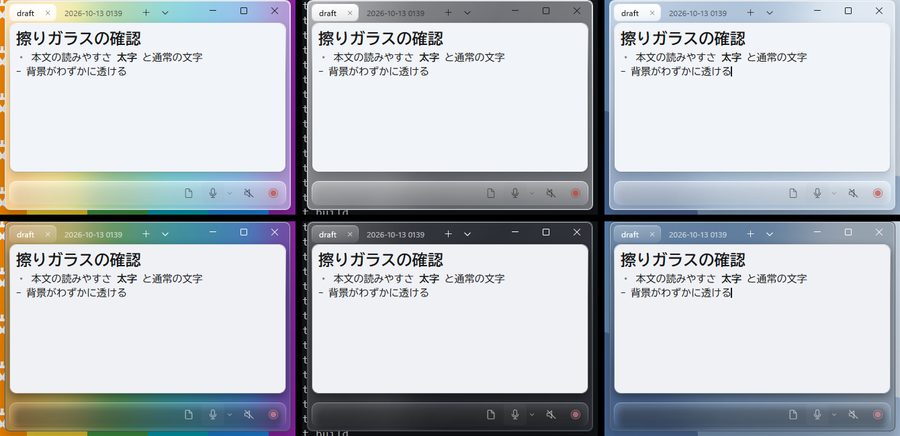
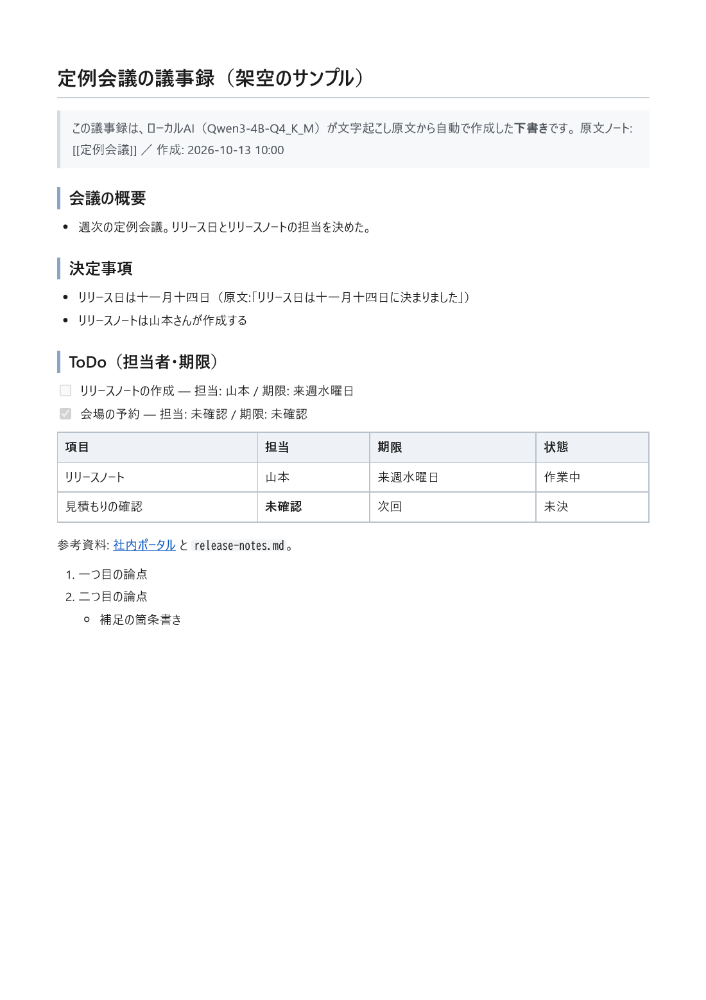
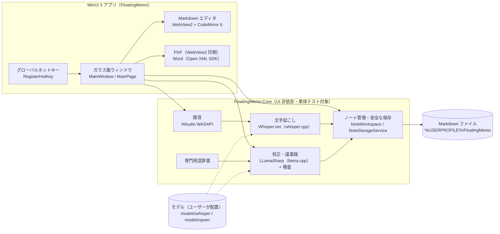
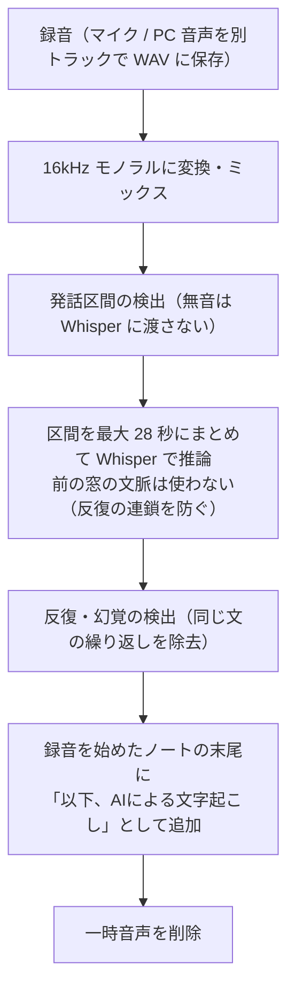
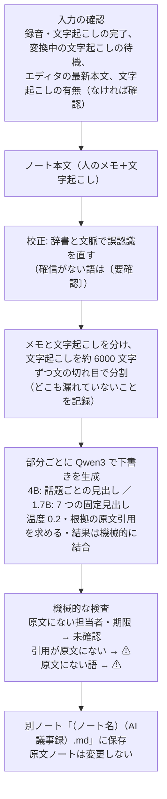

# Floating Memo

> 必要な瞬間だけ現れ、書くか話すだけで、ローカルに Markdown として残る。

Windows 11 用の、ローカルファーストなフローティングメモアプリです。
どのアプリを使っていても **Ctrl + Shift + M** で小さなガラス風のメモが現れ、
キーボードで書くか、録音して PC 内の Whisper で文字起こしし、**Esc** で消えます。
メモは自動で Markdown ファイルに保存されます。録音の文字起こしから、PC 内の小さな AI（Qwen3）で
議事録の下書きを作ることもできます（試作）。



> [!IMPORTANT]
> - **AI モデル（Whisper / Qwen3）は配布物に含まれていません。** 文字起こし・AI議事録を使うには、
>   [AIモデルの手動セットアップ](#aiモデルの手動セットアップ) の手順で公式の配布元から自分でダウンロードしてください。
>   モデルがなくても、メモの入力・自動保存・ノート管理・PDF / Word 書き出しは使えます。
> - アプリのコードにはクラウド API・テレメトリ・自動更新・モデルの自動ダウンロードはありません。
>   ただし Markdown エディタの土台である **WebView2 が Microsoft のサーバーへ接続することを確認しており、
>   その通信は止められていません**（[既知の制限](#既知の制限)）。完全なオフライン動作は保証していません。
> - 個人開発の試作品です。署名のない実行ファイルのため、初回起動時に Windows の警告が出ます。

---

## 目次

- [コンセプトと開発の背景](#コンセプトと開発の背景)
- [主な機能](#主な機能)
- [動作環境](#動作環境)
- [インストール（ポータブル版）](#インストールポータブル版)
- [AIモデルの手動セットアップ](#aiモデルの手動セットアップ)
- [キーボード操作](#キーボード操作)
- [専門用語辞書](#専門用語辞書)
- [PDF / Word 書き出し](#pdf--word-書き出し)
- [データの保存場所](#データの保存場所)
- [システム構成](#システム構成)
- [設計で考えたこと](#設計で考えたこと)
- [ソースからのビルド](#ソースからのビルド)
- [テスト](#テスト)
- [既知の制限](#既知の制限)
- [今後の予定](#今後の予定)
- [開発体制（Claude Code の利用）](#開発体制claude-code-の利用)
- [ライセンス](#ライセンス)

## コンセプトと開発の背景

会議中や作業中に「ちょっとメモしたい」とき、メモアプリを探して開き、ファイル名を決めて……という手間が
思考を途切れさせます。また、会議の録音や文字起こしをクラウドサービスに送ることに抵抗がある場面もあります。

Floating Memo は次の体験を目標にしています。

**Ctrl + Shift + M → 書く / 話す → Esc**

- 呼び出してから入力できるまで 0.5 秒以内（実測 平均 42ms）
- 保存ボタンなし。書いた内容は自動で素の Markdown ファイル（UTF-8）になり、Obsidian などでもそのまま開ける
- 音声・メモ・文字起こし・議事録の処理はこの PC の中で行う
- 画面は最小限。メモの邪魔をする装飾やダッシュボードは置かない

## 主な機能

| 機能 | 内容 |
|---|---|
| どこからでも呼び出し | `Ctrl+Shift+M` で表示（他のアプリの後ろにあれば前面へ）、もう一度で非表示 |
| すぐに書ける | 表示と同時に入力欄へフォーカス。日本語 IME 対応 |
| 複数ノート・タブ | タブは作業スペース、.md ファイルが保存データ。× は閉じるだけでファイルは消えない。再起動でタブを復元 |
| 保存済みノート一覧 | `Ctrl+O` で全ノートを一覧。名前・本文で検索、更新日時・名前で並べ替え |
| Markdown エディタ | ライブプレビュー（見出し・太字・リスト・チェックボックス・引用・コード・表など）。保存は常に素の Markdown |
| 自動保存 | 入力が 0.7 秒止まる・タブ切り替え・非表示・終了のたびに保存。一時ファイル→置換で書き込み、途中で落ちてもファイルが壊れない |
| 外部編集の保護 | 他のエディタで同じファイルが変更されたら無警告で上書きしない（もう一方を別ファイルに残す） |
| 録音 | マイク / PC で再生中の音（WASAPI ループバック）/ その両方。入力デバイスの選択、アイコン一体型の音量表示、マイク入力テスト |
| ローカル文字起こし | 録音停止後、PC 内の Whisper（whisper.cpp）で文字起こしし、録音を始めたノートの末尾に追加。無音区間は Whisper に渡さず、無音での反復（ハルシネーション）を抑制。進捗を % で表示 |
| AI議事録（試作） | 文字起こしノートから、PC 内の Qwen3（llama.cpp）で議事録の下書きを作り、別ノートに保存。原文は変更しない。Qwen3 4B では会議の話題ごとに見出しを立て、決定・作業・未決を【決定】・チェックボックス・【未決】で示す（1.7B は 7 つの固定見出し）。手で書いたメモと文字起こしは区別して AI に渡す。原文にない担当者・期限は「未確認」、根拠の引用が原文に見つからない項目は ⚠ で表示 |
| 文字起こしの校正 | 議事録の前に、専門用語辞書と文脈で聞き間違いを校正（確信がない語は〔要確認〕）。原文ノートは変更しない |
| PDF / Word 書き出し | `Ctrl+Shift+E` でノート全文または AI議事録のみを A4 の PDF / 編集できる Word（.docx）に書き出し |
| ガラス風 UI | 乳白色の本文カードを、背景がぼけて透けるガラス（タブ・操作バー）が囲むデザイン。透明感・乳白感は設定で調整 |

## 動作環境

| 項目 | 内容 |
|---|---|
| OS | Windows 11 x64（ARM 版 Windows は未確認） |
| 必要なもの | Microsoft Edge WebView2 ランタイム（Windows 11 に標準搭載。ない場合は簡易エディタで動作） |
| 管理者権限 | 不要 |
| メモリの目安 | メモだけ: 約 100MB ／ 文字起こし（Whisper base）: +約 170MB ／ AI議事録: Qwen3 1.7B で約 2.5GB、4B で約 3.5GB の空きが必要。**AI議事録を使うなら 8GB 以上、4B なら 16GB を推奨** |
| CPU | x64 の CPU。AI はすべて CPU で動きます（GPU は使いません）。開発 PC（Core i7-10700、8 コア）で、短い会議の議事録が 1.7B で約 40〜60 秒、4B で約 60〜100 秒 |
| ディスク | アプリ本体 約 330MB（展開後。ZIP は約 121MB）＋モデル（Whisper base 148MB、Qwen3 1.8〜2.5GB） |

ノート PC など、開発 PC より遅い環境では処理時間が長くなります。

## インストール（ポータブル版）

1. [Releases](https://github.com/pepemaru-bot/FloatingMemo/releases) から `FloatingMemo-Portable-v<バージョン>-x64.zip`（例: `FloatingMemo-Portable-v0.1.0-x64.zip`、約 121MB）をダウンロードします。
2. ZIP を右クリック →［プロパティ］→［許可する］にチェック →［OK］（SmartScreen の警告を減らすため。任意）。
3. ZIP を右クリック →［すべて展開］で、好きな場所（例: `C:\Tools\`）に展開します。ZIP の中から直接実行しないでください。
4. 展開したフォルダの `FloatingMemo.exe` をダブルクリックします。
   「Windows によって PC が保護されました」と出た場合は［詳細情報］→［実行］を選びます（署名のない個人作成アプリのため）。
5. 文字起こし・AI議事録を使う場合は、次の [AIモデルの手動セットアップ](#aiモデルの手動セットアップ) を行います。

インストーラーはありません。アンインストールはフォルダを削除するだけです（メモなどのデータは
[データの保存場所](#データの保存場所) に残ります）。.NET や Windows App SDK は ZIP に含まれているので、別途インストールは不要です。

展開後のフォルダ構成:

```
FloatingMemo-Portable-v0.1.0-x64\
├─ FloatingMemo.exe            ← これを起動
├─ README_PORTABLE.txt         使い方（日本語）
├─ THIRD_PARTY_NOTICES.txt     第三者ライセンス
├─ licenses\                   Microsoft コンポーネント等のライセンス全文
├─ models\
│  ├─ README_MODELS.txt        モデルの置き方
│  ├─ whisper\                 ← ggml-base.bin を置く（最初は空）
│  └─ qwen\                    ← Qwen3 の .gguf を置く（最初は空）
├─ Editor\                     Markdown エディタ（CodeMirror 6）
└─ （.NET / Windows App SDK / ライブラリの DLL など）
```

## AIモデルの手動セットアップ

アプリはモデルを自動でダウンロードしません。必要なものだけ、公式の配布元から自分でダウンロードしてください。

### 1. 文字起こし用: Whisper（必須）

| 項目 | 内容 |
|---|---|
| 配布元（公式） | https://huggingface.co/ggerganov/whisper.cpp/tree/main （whisper.cpp プロジェクト） |
| ファイル名 | **`ggml-base.bin`**（多言語版。`ggml-base.en.bin` は英語専用なので不可） |
| 形式・量子化 | GGML、量子化なし（f16） |
| サイズ | 147,951,465 バイト（約 148MB） |
| SHA-1 | `465707469ff3a37a2b9b8d8f89f2f99de7299dac`（whisper.cpp の models/README.md に記載の値） |
| ライセンス | MIT（OpenAI Whisper） |
| 置き場所 | `<展開したフォルダ>\models\whisper\ggml-base.bin` |

上のページで `ggml-base.bin` の行のダウンロードボタン（↓）を押すと保存できます。
精度を上げたい場合は `ggml-small.bin`（約 488MB、SHA-1 `55356645c2b361a969dfd0ef2c5a50d530afd8d5`）も使えます
（`ggml-base.bin` がないときに使われます。処理は遅くなります）。それ以外のファイル（`*-q5_1.bin` などの量子化版、
`large` 系など）は、アプリが自動では選びません。

### 2. AI議事録用: Qwen3（任意。どちらか一方でよい）

| | 軽量 | 標準 |
|---|---|---|
| 配布元（Qwen 公式） | https://huggingface.co/Qwen/Qwen3-1.7B-GGUF/tree/main | https://huggingface.co/Qwen/Qwen3-4B-GGUF/tree/main |
| ファイル名 | **`Qwen3-1.7B-Q8_0.gguf`** | **`Qwen3-4B-Q4_K_M.gguf`** |
| 形式・量子化 | GGUF、Q8_0 | GGUF、Q4_K_M |
| サイズ | 1,834,426,016 バイト（約 1.8GB） | 2,497,280,256 バイト（約 2.5GB） |
| SHA-256（開発時に取得したファイル） | `061b54daade076b5d3362dac252678d17da8c68f07560be70818cace6590cb1a` | `7485fe6f11af29433bc51cab58009521f205840f5b4ae3a32fa7f92e8534fdf5` |
| 必要メモリ（目安） | 約 2.5GB | 約 3.5GB |
| 特徴（架空データでの比較） | 速いが、内容の取り違え・重複が多め | 原文に忠実。既定ではこちらを優先 |
| ライセンス | Apache License 2.0 | Apache License 2.0 |
| 置き場所 | `<展開したフォルダ>\models\qwen\` | `<展開したフォルダ>\models\qwen\` |

ページの「Files and versions」で上記のファイル名の行のダウンロードボタン（↓）を押します。
SHA-256 は Hugging Face の各ファイルのページにも表示されます（配布元で更新された場合は値が変わることがあります）。
ほかの量子化（Q4_K_M 以外の 4B、8B など）の `.gguf` も一覧には出ますが、上の 2 つ以外は未評価です。

### 3. 配置後のフォルダ構成と確認

```
<展開したフォルダ>\models\
├─ whisper\
│  └─ ggml-base.bin
└─ qwen\
   ├─ Qwen3-1.7B-Q8_0.gguf      （どちらか一方、または両方）
   └─ Qwen3-4B-Q4_K_M.gguf
```

1. 配置したら、起動中の Floating Memo を右上の × で終了し、もう一度起動します。
2. 下部の議事録ボタン →「AIモデル・専門用語辞書の設定…」を開くと、見つかったモデルが一覧に出ます。
   両方置いた場合は、ここで使うモデルを選べます（選んでいないときは 4B → 1.7B の順に使います）。
3. `Ctrl + R` で録音を始め、もう一度 `Ctrl + R` で止めると文字起こしが始まります。
4. 文字起こしのあるノートで、議事録ボタン →「このノートからAI議事録を作成」を選びます。

ファイルの整合性を確かめたい場合は、PowerShell で次を実行し、上の表の値と比べます。

```powershell
Get-FileHash .\models\whisper\ggml-base.bin -Algorithm SHA1
Get-FileHash .\models\qwen\Qwen3-4B-Q4_K_M.gguf -Algorithm SHA256
```

### モデルを探す場所（上から順）

1. `<アプリのフォルダ>\models\whisper\`（Qwen は `models\qwen\`）
2. `<アプリのフォルダ>\models\`（以前のポータブル版の配置）
3. `%USERPROFILE%\FloatingMemo\models\whisper\`（Qwen は `...\models\qwen\`）
4. `%USERPROFILE%\FloatingMemo\models\`（以前の配置）

環境変数 `FLOATINGMEMO_MODELS_DIR` を設定すると、3・4 の `%USERPROFILE%\FloatingMemo\models` の代わりにそのフォルダを使います
（別のドライブにモデルを置く場合など）。アプリのフォルダを書き込みできない場所に置く場合は 3 を使ってください。

### トラブルシューティング

| 症状 | 原因と対処 |
|---|---|
| 録音後「Whisperモデル（ggml-base.bin）がありません」 | ファイル名・フォルダが違う。`models\whisper\ggml-base.bin` になっているか確認（ブラウザが `ggml-base (1).bin` のように名前を変えていないか）。配置後はアプリを再起動 |
| 「AIモデルがありません」 | `models\qwen\` に上の表のファイル名の `.gguf` があるか確認。ダウンロード途中の `.crdownload` / `.partial` は使えない |
| モデルの読み込みに失敗する | ダウンロードが途中で切れている可能性。サイズと SHA-1 / SHA-256 を確認し、再ダウンロード |
| 議事録の作成が非常に遅い・PC が重くなる | メモリ不足の可能性。1.7B を使う、他のアプリを閉じる |
| 文字起こしが空になる | 音が届いていない。マイク横の ▾ →「マイク入力テスト」で確認。「ステレオ ミキサー」はマイクではない |
| マイクで録音できない | Windows の［設定］→［プライバシーとセキュリティ］→［マイク］で、デスクトップ アプリのマイクへのアクセスをオン |

## キーボード操作

| キー | 動作 |
|---|---|
| `Ctrl + Shift + M` | メモの表示 / 非表示（どのアプリからでも） |
| `Esc` | メモを隠す（アプリは常駐したまま） |
| `Ctrl + R` | 録音開始 / 停止 |
| `Ctrl + N` / `Ctrl + W` | 新しいノート / タブを閉じる（ノートは削除されない） |
| `Ctrl + Tab` / `Ctrl + Shift + Tab` | 次 / 前のタブ |
| `Ctrl + Shift + T` | 最後に閉じたタブを開く |
| `Ctrl + Shift + E` | PDF / Word に書き出し |
| `Ctrl + O` | 保存済みノート一覧 |
| `F2` / タブをダブルクリック | ノート名の変更 |
| `Ctrl + S` | 今すぐ保存 |
| `Enter` / `Tab` / `Shift + Tab` | リストの継続 / 字下げ / 解除 |
| `Ctrl + B` / `Ctrl + I` | 太字 / 斜体 |
| `Ctrl + Z` / `Ctrl + Y` | 元に戻す / やり直し（文字起こしの挿入も取り消せる） |
| `F6` | エディタから下部のボタンへ移動 |
| 右上の × | アプリを終了 |

録音中に隠すと、完全には消えずに最小化されます（タスクバーに「● 録音中」と表示し、録音中であることが分かるようにするため）。

## 専門用語辞書

固有名詞や専門用語の聞き間違い（例: 「クロード」→「Claude」）を、AI議事録の前の校正で直すための辞書です。

- 議事録ボタン →「AIモデル・専門用語辞書の設定…」で、追加・編集・削除・JSON のインポート / エクスポートができます
- 1 語ごとに「正しい表記・別名・よくある誤認識・分類」を持てます（形式の例: [tests/e2e/fixtures/sample-lexicon.json](tests/e2e/fixtures/sample-lexicon.json)、架空のデータ）
- 辞書は最初は空です。文字起こしを手で直した箇所から登録候補を提案しますが、**承認するまで登録しません**。原文を自動で置き換えることもありません
- 保存先: `%USERPROFILE%\FloatingMemo\.floatingmemo\dictionary.json`

## PDF / Word 書き出し

`Ctrl + Shift + E`（または下部の議事録ボタン →「PDF / Word に書き出し…」）で、ノート全文または AI議事録のみを書き出します。

- **PDF**: A4・日本語フォント（游ゴシック等の Windows 標準フォント）。WebView2 の印刷機能で PC 内で作成
- **Word（.docx）**: Open XML SDK で作成。見出し・リスト・表・チェックボックスを Word の書式に変換し、そのまま編集できます
- 元の Markdown は変更しません。書き出し先は毎回選びます



## データの保存場所

| データ | 場所 | 備考 |
|---|---|---|
| メモ | `%USERPROFILE%\FloatingMemo\draft.md` と `notes\*.md` | UTF-8 の Markdown。OneDrive の同期対象（ドキュメント等）を避けた場所 |
| ノートの管理情報・辞書 | `%USERPROFILE%\FloatingMemo\.floatingmemo\` | ID 対応表・開いているタブ（本文は含まない）、専門用語辞書 `dictionary.json` |
| 設定 | `%LOCALAPPDATA%\FloatingMemo\settings.json` | 位置・サイズ・録音の選択など。本文は含まない |
| エディタのキャッシュ | `%LOCALAPPDATA%\FloatingMemo\WebView2\` | WebView2 のデータ |
| 録音の一時ファイル | `%TEMP%\FloatingMemo\recordings\` | 文字起こし成功後すぐ削除。失敗時のみ再試行用に一時保持し、終了時に削除 |
| 診断ログ | `%TEMP%\FloatingMemo\transcription-diagnostics.log`、`minutes-diagnostics.log` | 文字数・分割範囲・処理時間などの数値と短いハッシュのみ（本文・音声・名前は書かない） |
| クラッシュログ | `%TEMP%\FloatingMemo\crash.log` | 例外の種類・メッセージのみ |

アプリのフォルダには何も書き込みません。

## システム構成



### 文字起こし（Whisper）の流れ



### AI議事録（Qwen3）の流れ



### 技術スタック

| 分類 | 使用技術 |
|---|---|
| 言語・ランタイム | C# / .NET 10 |
| UI | WinUI 3（Windows App SDK 2.5.1）、Win32 interop（ホットキー・DWM） |
| エディタ | Microsoft Edge WebView2 + CodeMirror 6（同梱、MIT） |
| 録音 | NAudio 3.1（WASAPI キャプチャ / ループバック） |
| 文字起こし | Whisper.net 1.9.1（whisper.cpp） |
| AI議事録 | LLamaSharp 0.27.0（llama.cpp、CPU バックエンド）+ Qwen3 GGUF |
| 書き出し | Markdig 1.4.0、DocumentFormat.OpenXml 3.5.1、WebView2 PrintToPdf |
| テスト | xUnit、PowerShell + UI オートメーションによる E2E |

## 設計で考えたこと

- **ローカルファースト**: 録音・文字起こし・議事録をクラウドに送らない構成を最初に決め、Whisper.net と LLamaSharp で
  アプリのプロセス内で推論しています。Ollama のような別サーバーを使わないので、ZIP を展開するだけで動きます。
- **小さい AI を信用しすぎない**: AI議事録は「下書き」と明示し、出力をそのまま使わず機械的に検査します
  （原文にない担当者・期限を消す、引用が原文にあるか照合する等）。架空の会議データで 1.7B / 4B を同じ条件で比較し、
  重複・根拠のない決定などを数えて評価しています（[docs/evaluation](docs/evaluation/minutes-comparison-20261013.md)）。
- **メモを失わない**: 一時ファイル→置換での保存、外部エディタとの競合検知、録音・文字起こしが失敗してもメモ本文には
  触れない作りにしています。
- **Whisper の反復ハルシネーション対策**: 無音区間を渡さない・前の窓の文脈を引き継がない・反復を検出する、
  の 3 段で、無音や雑音で同じ文が延々と出る問題を抑えています。
- **WebView2 の制約への対処**: このバージョンの WinUI では WebView2 が透過と角丸の切り抜きに対応しないため、
  本文カードの余白と色を幾何学的に合わせて、角に四角い欠けが出ないようにしています。

## ソースからのビルド

必要なもの: Windows 11 x64、.NET 10 SDK、Visual Studio 2022 以降の「WinUI アプリケーション開発」ワークロード
（または Windows App SDK のビルドに必要な Windows SDK）、開発者モード（MSIX としてデバッグ実行する場合）。

```powershell
# 起動（Debug、MSIX パッケージとして実行）
dotnet run --project src\FloatingMemo\FloatingMemo.csproj -p:Platform=x64

# ポータブル版の ZIP を作る（モデルは含めない。dist\ に出力、Git 管理外）
powershell -ExecutionPolicy Bypass -File scripts\build-portable.ps1
```

開発用に `scripts\setup-model.ps1` で Whisper モデルを `%USERPROFILE%\FloatingMemo\models\whisper` にダウンロードすることもできます
（明示的に実行したときだけ通信し、SHA-1 を検証します）。

起動オプション（主に開発・テスト用）: `--notes-dir <フォルダ>` / `--model <Whisperモデル>` / `--llm-model <GGUF>` /
`--settings-file <ファイル>`。Debug ビルドのみテスト用のフック（`--fake-audio <wav>`、`--fake-llm` など）があります。

```
FloatingMemo/
├─ src/
│  ├─ FloatingMemo/            WinUI 3 アプリ（画面・ウィンドウ制御・ホットキー・書き出し）
│  │  └─ Editor/               Markdown エディタ（HTML/JS、CodeMirror 6 を vendor/ に同梱）
│  └─ FloatingMemo.Core/       UI に依存しないロジック（保存・録音・文字起こし・議事録・辞書・書き出し）
├─ tests/
│  ├─ FloatingMemo.Tests/      xUnit 単体テスト
│  └─ e2e/                     実アプリを UI オートメーションで操作する E2E テスト
├─ scripts/                    ポータブル版ビルド、開発用モデル取得、エディタ部品の更新
├─ docs/                       スクリーンショット、AI議事録の評価結果
├─ DEVELOPMENT_LOG.md          開発の経緯・技術判断・テスト結果
├─ FLOATING_MEMO_SPEC.md       製品仕様（初期）
└─ CLAUDE.md / PHASE1_START.md Claude Code への開発ルール・初回指示
```

## テスト

```powershell
# 単体テスト（モデルが必要なテストは、モデルがなければスキップ）
dotnet test tests\FloatingMemo.Tests\FloatingMemo.Tests.csproj -p:Platform=x64

# E2E テスト（Floating Memo を終了してから実行。Debug ビルドのテスト用フックを使う）
powershell -ExecutionPolicy Bypass -File tests\e2e\run-e2e.ps1

# ポータブル版のスモークテスト（展開したフォルダの exe を指定）
powershell -ExecutionPolicy Bypass -File tests\e2e\portable-smoke.ps1 -Exe <フォルダ>\FloatingMemo.exe
```

最新（main、2026-10-16）の結果:

| テスト | 結果 |
|---|---|
| 単体テスト（xUnit） | 213 件合格、10 件スキップ（実モデル・実デバイスが必要な計測・調査用。環境変数で有効化） |
| E2E（18 スイート） | 332 項目すべて合格（2 スイートは、文字起こしのないノートで確認を挟む新しい動作に合わせてテストを直し、再実行して合格） |

v0.1.0（2026-10-15）の結果:

| テスト | 結果 |
|---|---|
| 単体テスト（xUnit） | 191 件合格、7 件スキップ（実モデル・実デバイスが必要な計測用テスト。環境変数で有効化） |
| E2E（18 スイート） | 326 項目すべて合格（1 スイートは初回起動時の UI オートメーションの一時エラーで再実行して合格） |
| ポータブル版スモーク（モデルなし） | 11 項目合格（起動・入力・自動保存・二重起動防止・タブ復元・モデルがないときの案内） |
| ポータブル版スモーク（models\qwen に Qwen3 1.7B を配置） | 10 項目合格（AI議事録の作成まで。約 60 秒） |

未確認: ポータブル版で `models\whisper` に置いた Whisper モデルでの実際の録音・文字起こし（モデルの探索処理は単体テストで、
文字起こしそのものは E2E で確認済み）、Windows 11 以外・ARM・ノート PC での動作。

テストの安全設計:
- テスト用の音声は Windows の音声合成で生成し、会議データはすべて架空のもの。実際のマイク・スピーカーは使わない
- メモ・設定は一時フォルダを使い、普段使っているノートには触れない
- キー入力は、テスト中のアプリの入力欄にフォーカスがあることを確認してから送る

## 既知の制限

- **WebView2 の通信**: Markdown エディタの土台である WebView2（Microsoft Edge の部品）が、起動中に Microsoft の
  サーバーへ接続することを確認しています。Edge 自体の設定・更新などの通信と考えていますが、内容は確認できていません。
  エディタのページは外部と通信できない設定にしていますが、この接続自体は止められていません。
- **AI議事録は試作**: 小さいモデルのため、重複・ToDo の入れ忘れ・内容の取り違えがあります。必ず原文と照合してください。
  話題ごとの見出しは、架空の会議 2 件・Qwen3 4B での比較で固定見出しより重複や根拠のない記述が少なかったため採用しましたが、
  実際の会議での品質は確認できていません。1.7B は長い会議で話題を落としたため、固定見出しのままです。
- **リアルタイム文字起こしは未対応**: 録音停止後にまとめて処理します。長い録音ほど時間がかかります（CPU のみ）。
- **PC 音声はミックス全体**: 特定のアプリだけの音は録音できません。スピーカー使用時にマイクと同時録音すると二重に入ることがあります（ヘッドホン推奨）。
- **話者分離なし**: 誰が話したかは区別しません。
- **署名なし**: 実行ファイルにコード署名がないため、SmartScreen の警告が出ます。
- タスクトレイ常駐、Windows 起動時の自動起動、ホットキーの変更はありません。
- Windows 11 x64 以外（ARM、Windows 10）は未確認です。

## 今後の予定

予定であり、実装を約束するものではありません。

- AI議事録: 根拠付きの事実を先に抜き出してから議事録を書く方式（評価中）、GPU での高速化、議事録テンプレートの読み込み
- 「自分（マイク）／相手（PC 音声）」の区別、話者分離（sherpa-onnx など）
- 文字起こしモデルの比較（Whisper small / large-v3-turbo、日本語特化モデルなど）
- `[[ノート名]]` の Wiki リンクと補完
- タスクトレイ常駐、自動起動
- UI の改善

## 開発体制（Claude Code の利用）

このアプリは、プロダクトオーナー（リポジトリ所有者）が仕様・優先順位・設計の方針を決め、
**実装・テスト・ドキュメントの大部分を Anthropic の AI コーディングアシスタント Claude Code が作成**しました。
オーナーは各段階の指示、実機での動作確認とフィードバック、判断が必要な点の承認を行っています。
開発の経緯と技術判断は [DEVELOPMENT_LOG.md](DEVELOPMENT_LOG.md) に記録しています。
Claude Code への指示書（[CLAUDE.md](CLAUDE.md)、[PHASE1_START.md](PHASE1_START.md)、[FLOATING_MEMO_SPEC.md](FLOATING_MEMO_SPEC.md)）も公開しています。

## ライセンス

**Floating Memo 本体のライセンスは未定です（All rights reserved）。**
ソースコードは閲覧できるよう公開していますが、現時点では複製・改変・再配布・商用利用を許諾していません
（GitHub の利用規約で認められる範囲の閲覧・フォークを除く）。ライセンスを決めた時点でこの欄を更新します。

同梱している第三者のソフトウェアは、それぞれのライセンスに従います。

| コンポーネント | ライセンス |
|---|---|
| Whisper.net / whisper.cpp | MIT |
| LLamaSharp / llama.cpp | MIT |
| NAudio | MIT |
| CodeMirror 6 / Lezer ほか（`src/FloatingMemo/Editor/vendor/`） | MIT（各フォルダに LICENSE） |
| Markdig | BSD 2-Clause |
| DocumentFormat.OpenXml、CommunityToolkit、.NET | MIT |
| Microsoft Edge WebView2 SDK | BSD 形式（Microsoft） |
| Windows App SDK、Windows ML ランタイム（ONNX Runtime、DirectML を含む） | Microsoft ソフトウェア ライセンス条項（再配布可能なファイルとして同梱） |

詳細と全文は、配布 ZIP の `THIRD_PARTY_NOTICES.txt` と `licenses\`（リポジトリでは
[scripts/portable/THIRD_PARTY_NOTICES.txt](scripts/portable/THIRD_PARTY_NOTICES.txt)）を参照してください。
Microsoft のコンポーネントを含む配布物を使うことで、それらのライセンス条項にも同意したものとみなされます。

AI モデルは配布物に含まれません。ユーザーがダウンロードするモデルのライセンスは配布元に従います
（Whisper: MIT ／ Qwen3: Apache License 2.0）。

「Microsoft」「Windows」「Edge」は Microsoft グループの商標です。本アプリは Microsoft・OpenAI・Alibaba Cloud とは無関係です。
