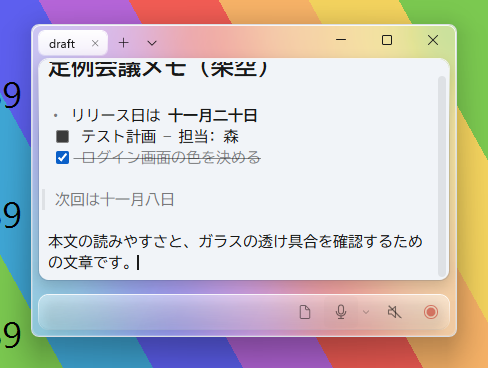
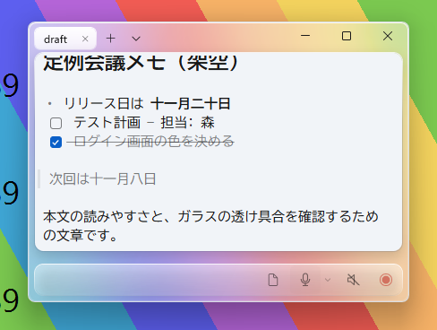
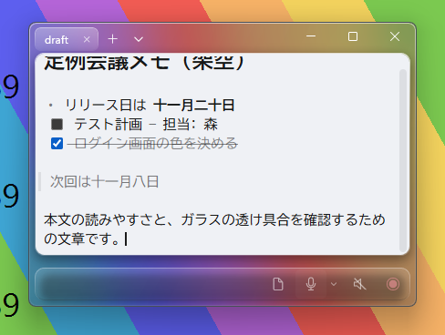
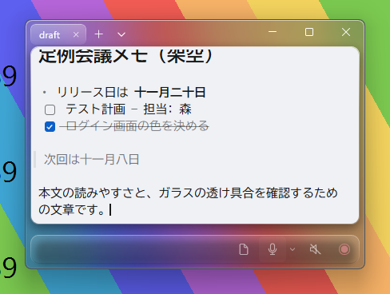

# UI の改善（apple-design スキルの原則を WinUI に適用、2026-10-15）

ブランチ `feature/apple-design-ui`（公開済みの v0.1.0 には含めていない）。
参考: [emilkowalski/skills の apple-design](https://github.com/emilkowalski/skills/tree/main/skills/apple-design)（MIT、SKILL.md のみ。スクリプトなし）。
Web 向けの内容のうち、このアプリ（WinUI 3 ＋ WebView2 のエディタ）に当てはまる原則だけを使った。

| 原則 | 変更 |
|---|---|
| Craft（細部が信頼をつくる） | 未完了タスクのチェックボックスが、ライト／ダークとも**黒い四角**に見えていた（ネイティブのチェックボックスがページの配色に従っていた）。枠線だけの四角＋完了時はアクセント色に白いチェック、を CSS で描くようにした |
| Response（押した瞬間の反応） | チェックボックスは押している間わずかに縮む（100ms） |
| Restraint / scroll indicators | 常に表示されていたスクロールバーを、ポインターが本文の上にあるときだけ表示 |
| Vibrancy（素材の上の文字・アイコンは見やすく） | 入力中に薄くする下部の操作バーを 55% → 72% に（派手な背景の上でアイコンが見えにくかった） |
| Typography（サイズ別の行間・字間） | 見出しは行間を詰め、字間をわずかに詰める。本文は字間 0・行間 1.6 のまま |
| Reduced motion | Windows の「アニメーション効果」がオフなら、録音中の赤い点を点滅させない。チェックボックスの動きも止める（`prefers-reduced-motion`） |

変更しなかったもの: 本文カード（WebView2）の背景・余白・角。WebView2 が透過と角の切り抜きに対応しないため、
以前直した「角の白い欠け」を再発させないよう、エディタの中身（文字・チェックボックス・スクロールバー）だけを変えた。

スクリーンショット（合成した背景、架空のメモ。左: 変更前、右: 変更後）:

| | 変更前 | 変更後 |
|---|---|---|
| ライト |  |  |
| ダーク |  |  |

テスト: E2E の markdown・appearance・chrome・ui・recording（88 項目）合格。角の欠けがないことは画像で確認。
未確認: Windows の「アニメーション効果」オフでの実機表示、ハイコントラストでのチェックボックス。
